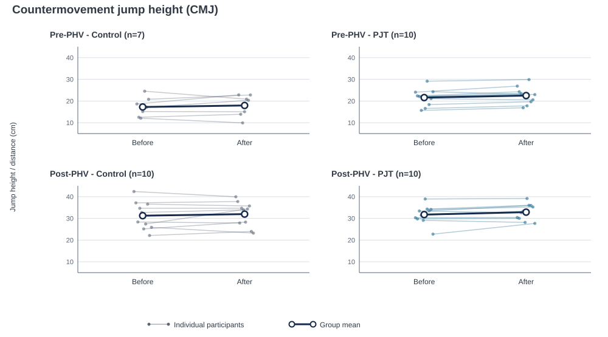
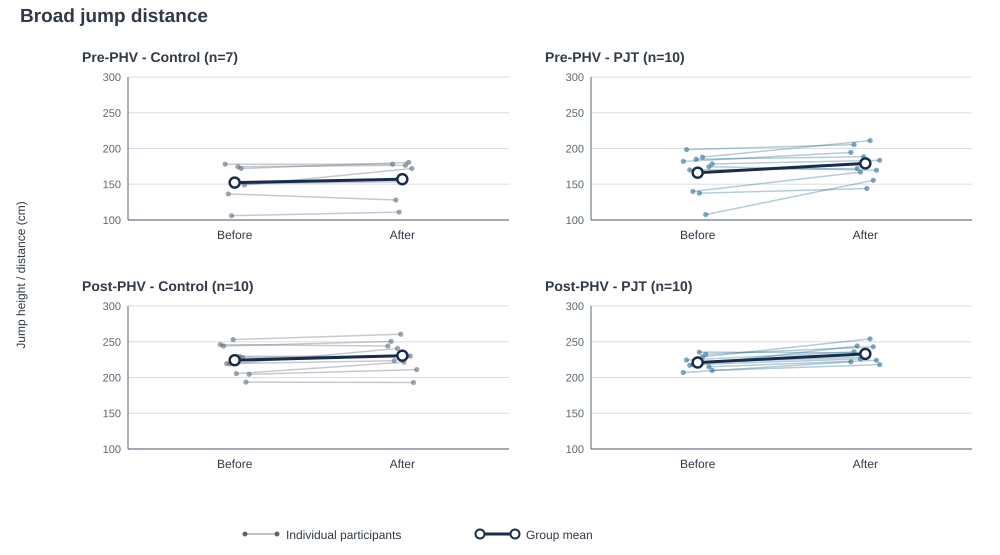
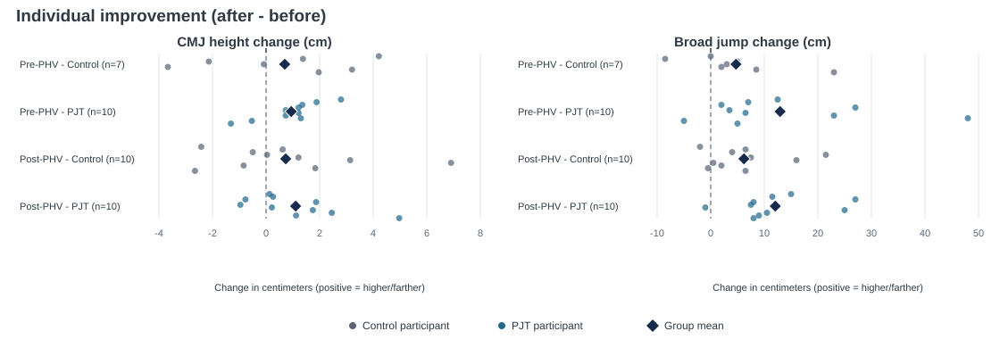

This page analyzes **published research data**, not measurements I collected. The source is [the original study](https://doi.org/10.1371/journal.pone.0349011) and its [Zenodo dataset](https://doi.org/10.5281/zenodo.17881834).

For each participant, I averaged the available trials at each time point. Improvement is calculated as **after minus before**, in centimeters. The graphs include participants with paired measurements and separate the control and plyometric jump training (PJT) groups by maturity status (pre- or post-PHV).

## Vertical jump: countermovement jump

Each light line connects one participant's before and after average. The dark line shows that group's average.

{fig-alt="Four-panel connected-dot graph of individual countermovement jump heights before and after training. Panels compare control and plyometric training groups within pre- and post-PHV maturity groups; thin lines are participants and dark lines are group means."}

## Broad jump

{fig-alt="Four-panel connected-dot graph of individual broad jump distances before and after training. Panels compare control and plyometric training groups within pre- and post-PHV maturity groups; thin lines are participants and dark lines are group means."}

## Distribution of individual changes

Each dot represents one participant's change; diamonds show group means. The dashed vertical line at zero marks no change. Positive values mean a higher CMJ or farther broad jump after the study period; negative values mean a lower value.

{fig-alt="Dot distributions of individual after-minus-before changes for countermovement jump and broad jump. Rows separate pre- and post-PHV control and plyometric training groups. The dashed line marks zero change and diamonds mark group means."}

## Group summaries

Values are group means of participant-level trial averages. “Improved” counts participants whose after-minus-before change was greater than zero.

| Maturity group | Training group | n | CMJ before → after (cm) | CMJ improved | Broad jump before → after (cm) | Broad jump improved |
|---|---|---:|---:|---:|---:|---:|
| Pre-PHV | Control | 7 | 17.26 → 17.96 | 4/7 | 152.36 → 157.07 | 5/7 |
| Pre-PHV | PJT | 10 | 21.58 → 22.52 | 8/10 | 166.15 → 179.10 | 9/10 |
| Post-PHV | Control | 10 | 31.23 → 31.96 | 6/10 | 224.25 → 230.45 | 8/10 |
| Post-PHV | PJT | 10 | 31.75 → 32.85 | 8/10 | 220.95 → 233.00 | 9/10 |

These are descriptive comparisons, and individual results vary within every group. The study reported no significant time-by-intervention-by-maturity interaction for any outcome; the observed changes alone do not show that PJT caused the differences.
