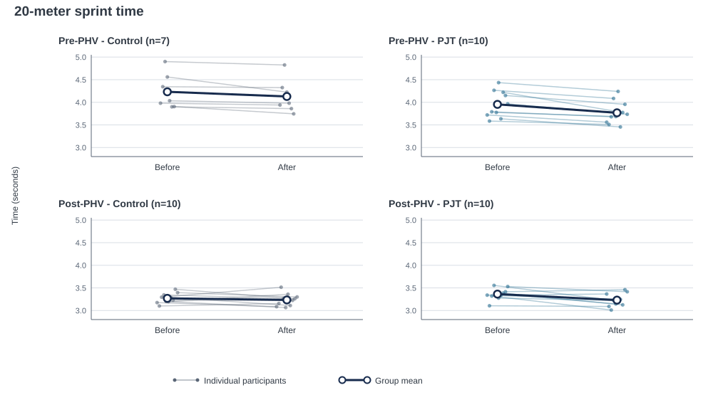
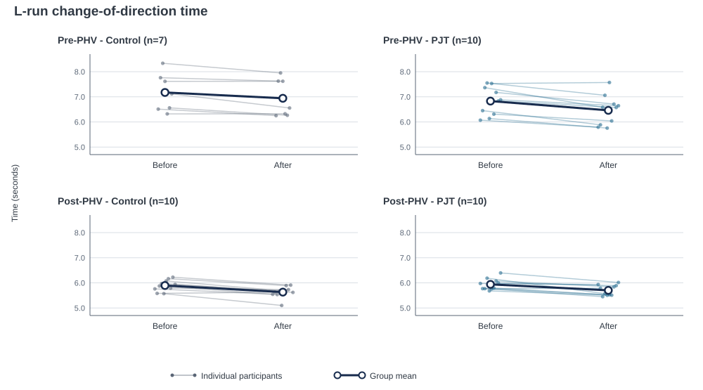

This page analyzes **published research data**, not measurements I collected. The source is [the original study](https://doi.org/10.1371/journal.pone.0349011) and its [Zenodo dataset](https://doi.org/10.5281/zenodo.17881834).

**Lower times mean better performance.** For each participant, I averaged the available trials at each time point. Each light line connects one participant's before and after average; the dark line shows the group mean. Panels separate the control and plyometric jump training (PJT) groups by maturity status. PHV means peak height velocity; the PJT group received additional plyometric sessions, while the control group continued usual soccer training.

## 20-meter sprint

Sprint times are measured in seconds.

{fig-alt="Four-panel connected-dot graph of individual 20-meter sprint times in seconds before and after the study. Panels compare control and plyometric training groups within pre- and post-PHV maturity groups. Thin lines are participants and dark lines are group means; lower times are better."}

## Change of direction: L-run

The L-run assesses change-of-direction performance. Times are measured in seconds.

{fig-alt="Four-panel connected-dot graph of individual L-run change-of-direction times in seconds before and after the study. Panels compare control and plyometric training groups within pre- and post-PHV maturity groups. Thin lines are participants and dark lines are group means; lower times are better."}

## Group summaries

Changes are calculated as after minus before, in seconds; a negative change means a faster time. “Faster” counts participants whose time decreased.

| Maturity group | Training group | n | Sprint before → after (s) | Faster | L-run before → after (s) | Faster |
|---|---|---:|---:|---:|---:|---:|
| Pre-PHV | Control | 7 | 4.23 → 4.13 | 7/7 | 7.17 → 6.94 | 5/7 |
| Pre-PHV | PJT | 10 | 3.95 → 3.77 | 10/10 | 6.83 → 6.46 | 9/10 |
| Post-PHV | Control | 10 | 3.27 → 3.23 | 7/10 | 5.89 → 5.63 | 9/10 |
| Post-PHV | PJT | 10 | 3.36 → 3.23 | 8/10 | 5.94 → 5.70 | 9/10 |

These are descriptive paired comparisons. They show individual and group changes, but by themselves do not establish that PJT caused the changes.
